# Representational structure, and the cross-seed replication

**Meeting document, 30 July 2026 · Priyam Rai**

**Part I** is our new structural work: shattering, manifold capacity, dimensionality and timing. **Part II**
takes the ten-notebook information analysis from one seed to all twenty.

Every comparison is within-seed paired over 20 seeds, 40 networks. Each pair shares initial weights, data
order and training schedule; the only free difference is the hidden membrane time constant. Δ is het minus
hom, *d*z is Cohen's *d* for paired differences, and the primary test is an exact sign-flip
permutation over all 220 sign assignments. Wins counts the seeds on which het is higher.

> † The Wilcoxon and sign-flip tests both floor at 2/2²⁰ = 1.9×10⁻⁶ at this n, which is what a unanimous 20/20 reads as. A p marked † sits on that floor: it is a maximally significant result, not a weak one.

**On the figures.** Bars are means over the twenty networks, whiskers are 95% CI on the mean, faint dots are
individual networks, and each bar group carries its own permutation p and win count. Sweeps are drawn as
lines with a shaded 95% CI band. Nothing here uses connected paired slopes any more.

---

## Contents

**Part I. Representational structure**
1. [Where the two networks start](#1-where-the-two-networks-start)
2. [Shattering dimensionality](#2-shattering-dimensionality)
3. [Rank-resolved shattering: where the structure lives](#3-rank-resolved-shattering-where-the-structure-lives)
4. [Manifold capacity](#4-manifold-capacity)
5. [Signal dimensionality and temporal generalisation](#5-signal-dimensionality-and-temporal-generalisation)
6. [Part I in one table](#6-part-i-in-one-table)

**Part II. Cross-seed replication**
7. [What was replicated, and a fidelity check](#7-what-was-replicated-and-a-fidelity-check)
8. [Modularity](#8-modularity)
9. [Redundancy and synergy](#9-redundancy-and-synergy)
10. [Timing and lock-in order](#10-timing-and-lock-in-order)
11. [Division of labour](#11-division-of-labour)
12. [Part II in one table](#12-part-ii-in-one-table)

---
---

# Part I. Representational structure

## 1. Where the two networks start

| Metric | het | hom | Δ | d_z | paired t | Wilcoxon | sign-flip | wins |
|---|---:|---:|---:|---:|---:|---:|---:|---:|
| Task accuracy | 0.703 | 0.602 | +0.1013 | +1.59 | 9.3e-07 | 1.9e-05 | 1.3e-05 | 18/20 |
| Linear decoder accuracy | 0.832 | 0.743 | +0.0889 | +1.98 | 3.5e-08 | 5.7e-06 | 5.7e-06 | 19/20 |
| PCA n₉₀ | 27.5 | 22.2 | +5.25 | +0.88 | 9.1e-04 | 0.002 | 7.2e-04 | 17/20 |
| PCA participation ratio | 11.00 | 7.67 | +3.329 | +0.65 | 0.009 | 0.017 | 0.010 | 14/20 |
| PC-reconstruction @ m=16 | 0.604 | 0.530 | +0.0744 | +1.15 | 5.7e-05 | 3.2e-04 | 1.9e-04 | 16/20 |
| PC-reconstruction @ m=32 | 0.671 | 0.591 | +0.08004 | +1.43 | 3.9e-06 | 1.9e-04 | 2.9e-05 | 18/20 |
| Active units | 57.6 | 58.8 | -1.15 | -0.38 | 0.108 | 0.120 | 0.125 | 7/20 |
| Mean firing rate | 0.130 | 0.095 | +0.03482 | +0.59 | 0.016 | 0.015 | 0.018 | 17/20 |

Active units is a null: het is not recruiting more units, so the advantage is not recruitment.

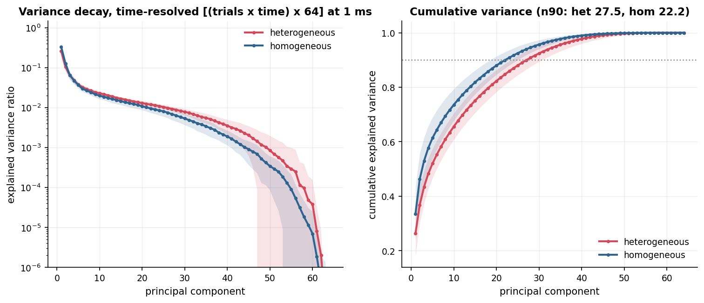
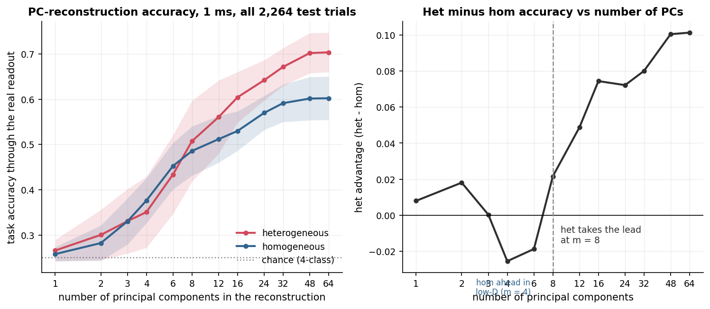

---

## 2. Shattering dimensionality

Bernardi et al. 2020, run on two condition sets. Labels attach to **conditions**, not trials, so this is
geometry rather than trial noise; balanced dichotomies put chance at exactly 0.50.

| Set | Conditions | Trials/condition | Dichotomies |
|---|---:|---:|---|
| A | 8 (digit 0–3 × language) | 100 | 35, exhaustive |
| B | 20 (digit 0–9 × language) | 100 | 200 sampled |

| Set | het | hom | Δ | d_z | paired t | Wilcoxon | sign-flip | wins |
|---|---:|---:|---:|---:|---:|---:|---:|---:|
| A, 8 conditions | 0.8487 | 0.8008 | +0.04788 | +1.88 | 7.8e-08 | 9.5e-06 | 7.6e-06 | 18/20 |
| B, 20 conditions | 0.8354 | 0.7811 | +0.05421 | +2.07 | 1.7e-08 | 5.7e-06 | 5.7e-06 | 19/20 |

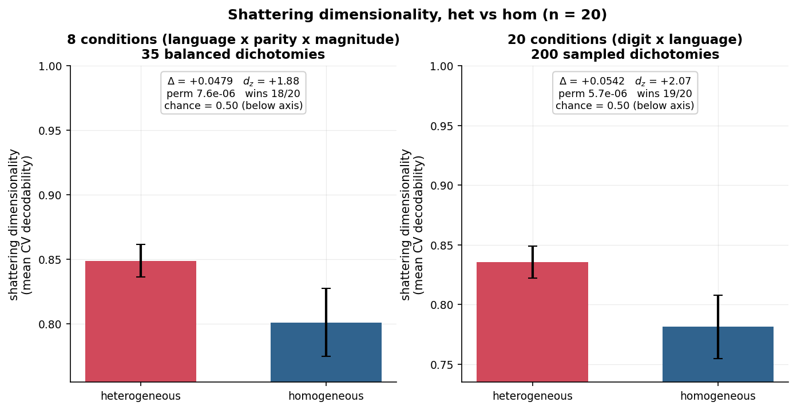
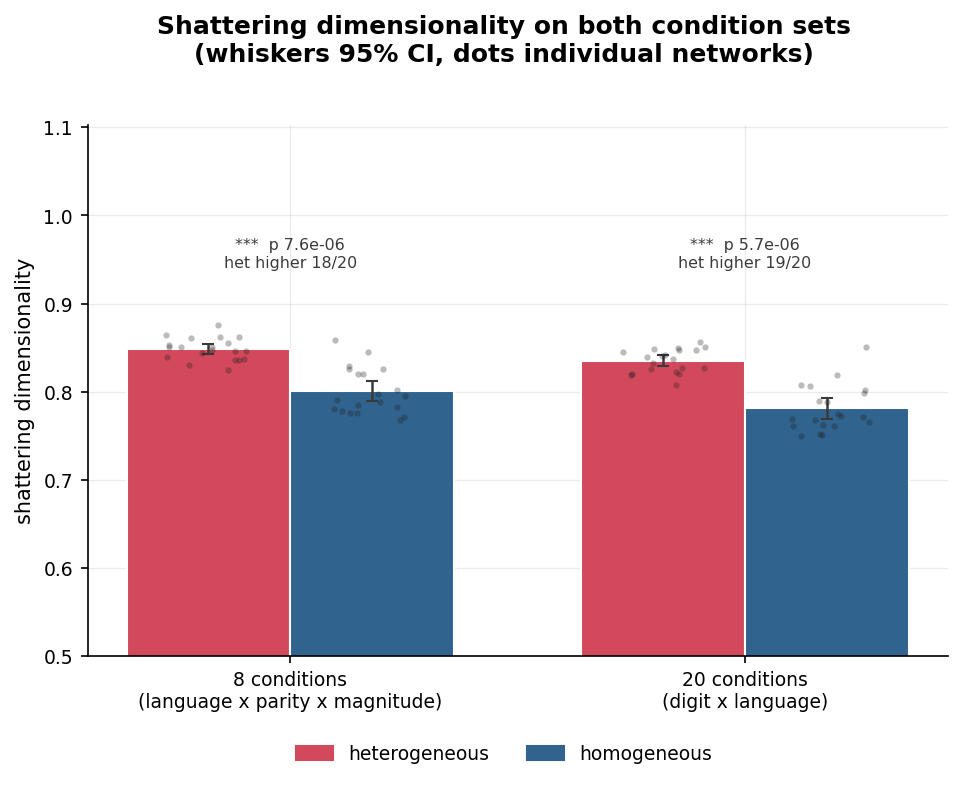

The finer partition gives the larger gap, which is the informative direction.

---

## 3. Rank-resolved shattering: where the structure lives

Shattering recomputed from the top *m* principal components, *m* = 1 to 64. **The PCA is fitted inside each
cross-validation fold and is label-free**, so no test-set information leaks through the reconstruction.

| Retained rank m | het | hom | Δ | d_z | paired t | Wilcoxon | sign-flip | wins |
|---|---:|---:|---:|---:|---:|---:|---:|---:|
| 1 | 0.580 | 0.570 | +0.01017 | +0.64 | 0.010 | 0.006 | 0.008 | 16/20 |
| 2 | 0.629 | 0.610 | +0.01898 | +0.69 | 0.006 | 0.014 | 0.006 | 16/20 |
| 3 | 0.658 | 0.633 | +0.02456 | +1.18 | 4.1e-05 | 6.3e-05 | 7.6e-05 | 18/20 |
| 4 | 0.672 | 0.652 | +0.02065 | +1.07 | 1.3e-04 | 3.6e-05 | 3.2e-05 | 18/20 |
| 6 | 0.701 | 0.672 | +0.02903 | +1.45 | 3.4e-06 | 1.3e-05 | 9.5e-06 | 19/20 |
| 8 | 0.720 | 0.689 | +0.0316 | +1.22 | 2.9e-05 | 3.6e-05 | 3.2e-05 | 19/20 |
| 12 | 0.747 | 0.711 | +0.03527 | +1.65 | 5.5e-07 | 1.9e-06 † | 1.9e-06 † | 20/20 |
| 16 | 0.766 | 0.725 | +0.04067 | +1.90 | 7.0e-08 | 3.8e-06 | 3.8e-06 | 19/20 |
| 24 | 0.797 | 0.750 | +0.04742 | +2.47 | 1.0e-09 | 1.9e-06 † | 1.9e-06 † | 20/20 |
| 32 | 0.818 | 0.769 | +0.04902 | +2.37 | 2.1e-09 | 3.8e-06 | 3.8e-06 | 19/20 |
| 48 | 0.843 | 0.795 | +0.04789 | +2.00 | 3.1e-08 | 5.7e-06 | 5.7e-06 | 19/20 |
| 64 | 0.848 | 0.801 | +0.04709 | +1.87 | 8.6e-08 | 9.5e-06 | 7.6e-06 | 18/20 |

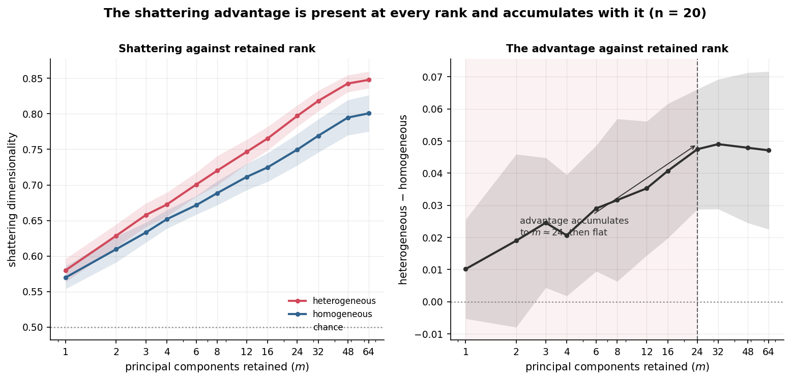

I expected equivalence in the top components and divergence in the tail. Instead **het leads from m = 1**
(p = 0.008) and the gap widens monotonically to a maximum near m = 24, so the advantage is not a tail
phenomenon.

---

## 4. Manifold capacity

Replica mean-field theory (Chung et al. 2018; Cohen et al. 2020): capacity α_M plus the geometry that
determines it, manifold radius R_M, manifold dimension D_M, and centroid correlation.

**Implementation note, because it changed the answer.** The uncorrected estimator gave a null. That was the
omitted centre-correlation stage, not a result: the reference implementation's low-rank subtraction needs
`pymanopt`, whose API changed. The pipeline was ported to pymanopt 2.x and both the uncorrected core and the
corrected port were validated on synthetic manifolds before use. An earlier toy validation also
mis-normalised by subtracting each manifold's own mean, inflating R_M to order 10⁸; fixed by subtracting the
global mean and keeping each manifold's centre.

**Set B, 20 digit-by-language manifolds:**

| Metric | het | hom | Δ | d_z | paired t | Wilcoxon | sign-flip | wins |
|---|---:|---:|---:|---:|---:|---:|---:|---:|
| Manifold capacity α_M | 0.1909 | 0.1494 | +0.04143 | +1.44 | 3.5e-06 | 3.6e-05 | 3.2e-05 | 18/20 |
| Manifold radius R_M | 1.2643 | 1.3403 | -0.07598 | -1.09 | 1.1e-04 | 5.7e-06 | 5.7e-06 | 19/20 |
| Manifold dimension D_M | 7.967 | 10.206 | -2.239 | -1.51 | 1.8e-06 | 1.9e-05 | 1.9e-05 | 18/20 |
| Centroid correlation | 0.4534 | 0.5814 | -0.128 | -0.86 | 0.001 | 0.002 | 0.001 | 17/20 |

**Set A, 8 condition manifolds:**

| Metric | het | hom | Δ | d_z | paired t | Wilcoxon | sign-flip | wins |
|---|---:|---:|---:|---:|---:|---:|---:|---:|
| Manifold capacity α_M | 0.1786 | 0.1400 | +0.03861 | +1.04 | 1.7e-04 | 2.6e-04 | 1.8e-04 | 17/20 |
| Manifold radius R_M | 1.3533 | 1.4414 | -0.08809 | -0.54 | 0.027 | 0.024 | 0.020 | 16/20 |
| Manifold dimension D_M | 8.148 | 10.455 | -2.306 | -1.07 | 1.3e-04 | 1.7e-04 | 1.0e-04 | 18/20 |
| Centroid correlation | 0.4846 | 0.6501 | -0.1655 | -0.90 | 7.2e-04 | 0.002 | 0.001 | 16/20 |

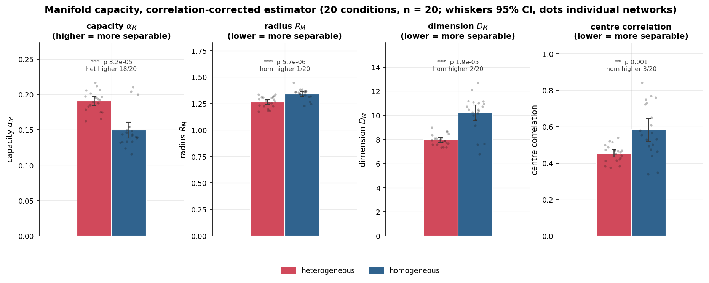
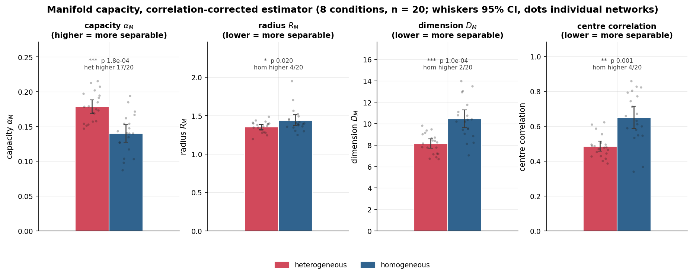

Radius, dimension and centroid correlation all fall together, so these four rows are **one result, not
four**: orchestrated reduction in Cohen's sense.

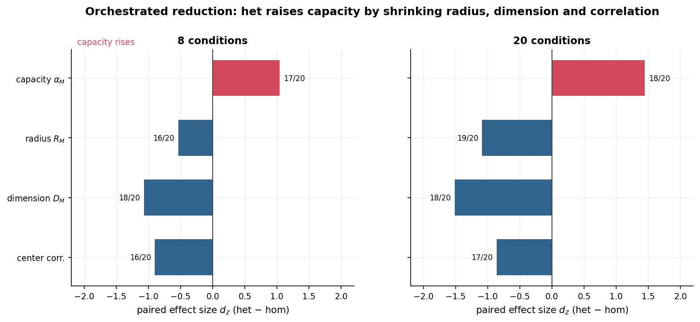
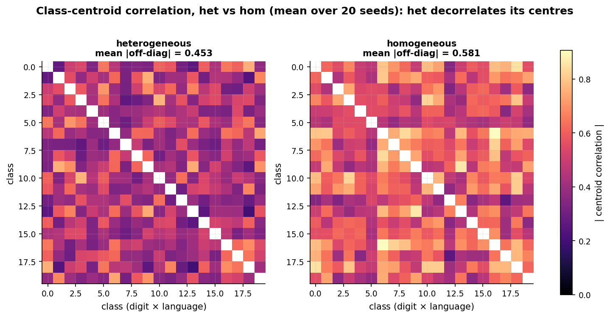
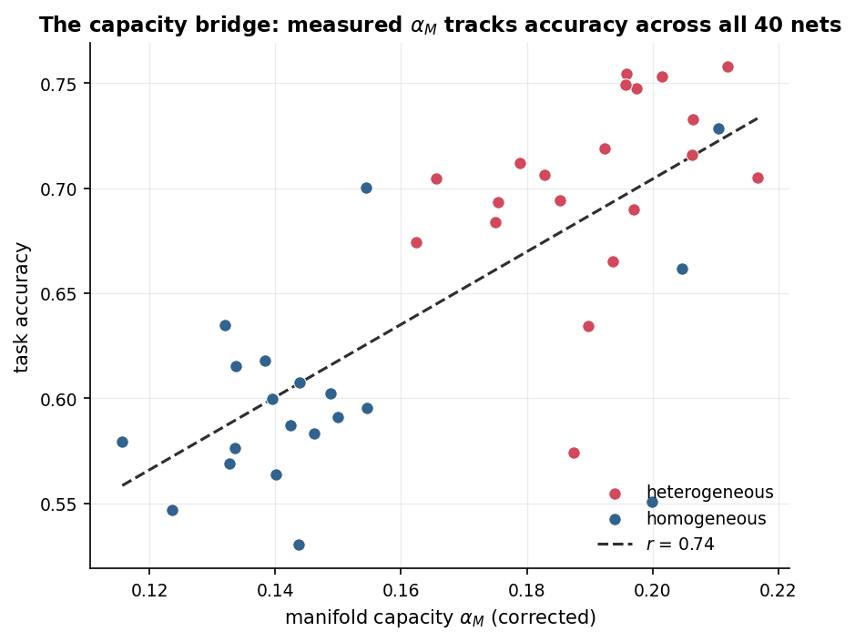

---

## 5. Signal dimensionality and temporal generalisation

### Signal dimensionality (cvPCA, Stringer et al. 2019)

| Metric | het | hom | Δ | d_z | paired t | Wilcoxon | sign-flip | wins |
|---|---:|---:|---:|---:|---:|---:|---:|---:|
| Signal participation ratio | 3.167 | 2.253 | +0.9149 | +0.63 | 0.011 | 0.021 | 0.012 | 14/20 |
| Reliable directions | 61.4 | 60.4 | +1 | +0.31 | 0.176 | 0.153 | 0.197 | 13/20 |

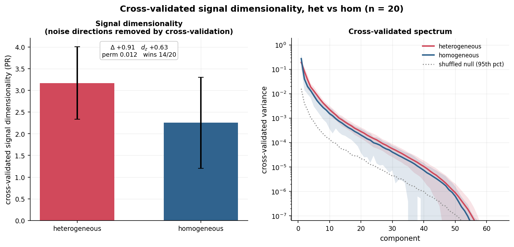

The second row is a null: essentially every direction carries *some* reliable signal in both arms. **Two
sub-metrics from the first pass were dropped as degenerate**: `n_signal` sat at 63/64 for every network and
`signal_frac` was exactly 1.000, because the cross-validated eigenvalue is non-negative by construction.
They were replaced by the shuffle-null test reported here.

### Temporal generalisation (King & Dehaene 2014)

| Metric | het | hom | Δ | d_z | paired t | Wilcoxon | sign-flip | wins |
|---|---:|---:|---:|---:|---:|---:|---:|---:|
| Instantaneous decoding (diagonal) | 0.5768 | 0.4568 | +0.12 | +1.39 | 5.6e-06 | 6.3e-05 | 5.0e-05 | 17/20 |
| Cross-time decoding (off-diagonal) | 0.3498 | 0.3011 | +0.04874 | +1.16 | 5.2e-05 | 3.2e-04 | 1.9e-04 | 19/20 |
| Generalisation ratio | 0.3010 | 0.2386 | +0.06242 | +0.81 | 0.002 | 0.002 | 0.002 | 17/20 |
| Long-lag accuracy | 0.2770 | 0.2568 | +0.02013 | +0.74 | 0.004 | 0.001 | 0.004 | 17/20 |
| Long-lag / diagonal | 0.0794 | 0.0250 | +0.05439 | +0.66 | 0.008 | 0.011 | 0.008 | 17/20 |
| Generalisation width (bins) | 7.81 | 8.03 | -0.2179 | -0.10 | 0.674 | 0.701 | 0.672 | 8/20 |

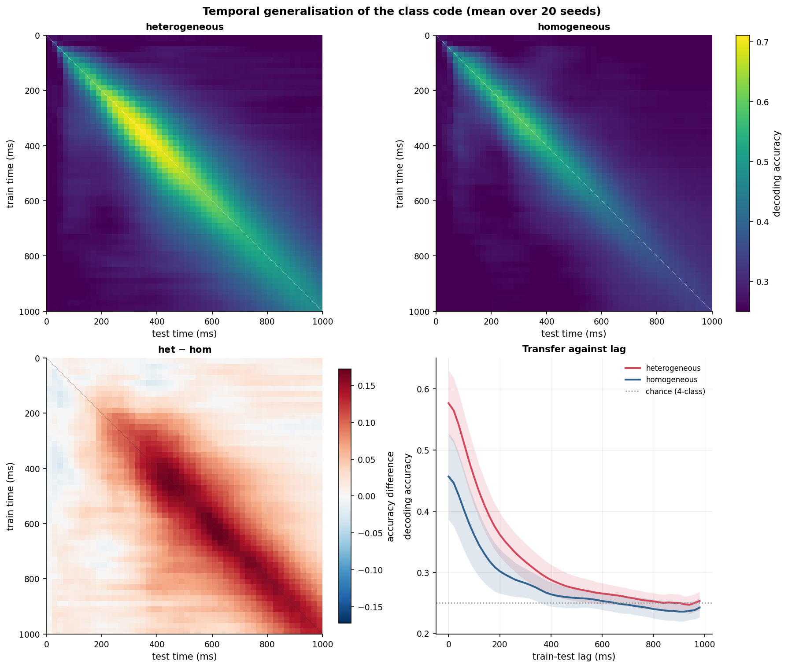

Window *width* is a null. The het advantage sits at **long lags** specifically, more than three times the
diagonal ratio, which is a different claim from "better at every lag".

---

## 6. Part I in one table

| Question | Measure | Answer |
|---|---|---|
| Does het separate arbitrary stimulus groupings better? | Shattering, 8 and 20 conditions | **Yes**, d_z 1.9–2.1, 18–19/20 |
| Where along the spectrum? | Rank-resolved shattering | **Everywhere**, leading from m = 1, widest around m = 24 |
| Can a readout separate more classes per unit? | Manifold capacity α_M | **Yes** at 8 and 20 manifolds, +0.041, d_z 1.44, 18/20 |
| Why? | R_M, D_M, centroid correlation | All three fall together: orchestrated reduction |
| More reliable signal directions? | cvPCA participation ratio | **Yes**, +0.92, p = 0.012 |
| More reliable *count* of directions? | cvPCA reliable directions | **No**, a null |
| Does the code persist over time? | Temporal generalisation | **Yes at long lags**, ratio 3× higher; window width is a null |

**One line.** Heterogeneity does not add dimensions; it makes the dimensions that already exist carry
reliable, generalisable, temporally persistent structure, across the whole spectrum rather than in a tail.

---
---

# Part II. Cross-seed replication

## 7. What was replicated, and a fidelity check

The package runs its notebooks on **seed 1001 alone**. Four analyses were extended to all twenty pairs:
functional-network modularity, pairwise RSI, temporal lock-in order, division of labour.

**The implementation reproduces the package's numbers on the seed they share**, which is what licenses
reading any disagreement below as a fact about sampling rather than about code:

| Quantity | Package (seed 1001) | This code (seed 1001) |
|---|---|---|
| Full-graph Q/Q_rand | het 0.62, hom 1.39 | het 0.626, hom 1.365 |
| Cumulative-count Q/Q_rand | het 1.10, hom 1.87 | het 1.118, hom 1.810 |
| Active units | het 47, hom 42 | het 47, hom 42 |
| Mean edge MI (bits) | het 0.021, hom 0.012 | het 0.0205, hom 0.0123 |
| η²(SI ~ module) | het 0.09 (p 0.26), hom 0.27 (p 0.007) | het 0.090 (p 0.257), hom 0.274 (p 0.006) |
| hom lock-in, language then parity | 232 ms, 408 ms | 217 ms, 403 ms |

So where twenty seeds disagree with one, the disagreement is about sampling, not about code.

**One change of substance: the unit of analysis.** The package tests pair-level results with a Mann-Whitney
over unit pairs (p < 1e-4). Pairs inside a network share units, training run and seed, so the effective n is
far below the nominal one and that p describes variation among pairs, not between architectures. Here each
network contributes one number and the twenty within-seed differences are the unit. Pair-level distributions
are still plotted, as description.

---

## 8. Modularity

**Claim under test.** *"het's graph is near-random / diffuse; hom's is modular + small-world. Full graph:
het 0.62 (below random!), hom 1.39."*

**Verdict: replicates, but not through Q/Q_rand.**

### 8a. By the package's statistic, a null

Unthresholded graphs, no edge discarded:

| Metric | het | hom | Δ | d_z | paired t | Wilcoxon | sign-flip | wins |
|---|---:|---:|---:|---:|---:|---:|---:|---:|
| Full-graph Q/Q_rand | 0.573 | 0.674 | -0.1012 | -0.25 | 0.281 | 0.231 | 0.280 | 7/20 |
| Cumulative-count Q/Q_rand | 1.251 | 1.018 | +0.2325 | +0.42 | 0.073 | 0.097 | 0.074 | 14/20 |
| Small-worldness σ, full graph | 0.507 | 0.395 | +0.1111 | +0.45 | 0.060 | 0.058 | 0.060 | 14/20 |
| Small-worldness σ, cumulative | 0.726 | 0.561 | +0.1656 | +0.97 | 3.5e-04 | 0.001 | 6.2e-04 | 16/20 |
| Communities found, full graph | 3.50 | 3.10 | +0.4 | +0.40 | 0.088 | 0.083 | 0.136 | 9/20 |
| Communities found, cumulative | 3.40 | 2.75 | +0.65 | +0.97 | 3.5e-04 | 0.002 | 0.001 | 11/20 |

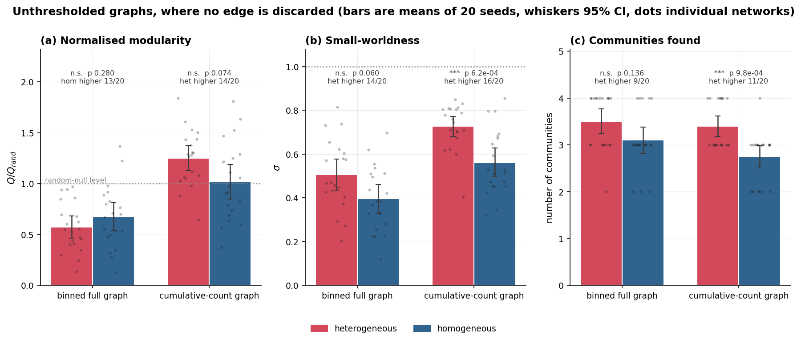

Three things need explaining and one explanation covers all three. Seed 1001's homogeneous network is **rank
20/20** on both graphs (z = +2.22 binned, +2.03 cumulative). The cumulative graph appears to reverse. And on
the binned graph **neither arm reaches 1.0**, with σ below 1 in every cell above: the real graphs would be
*less* modular and *less* clustered than their own randomisations. That points at the denominator.

### 8b. Why that null is about the statistic

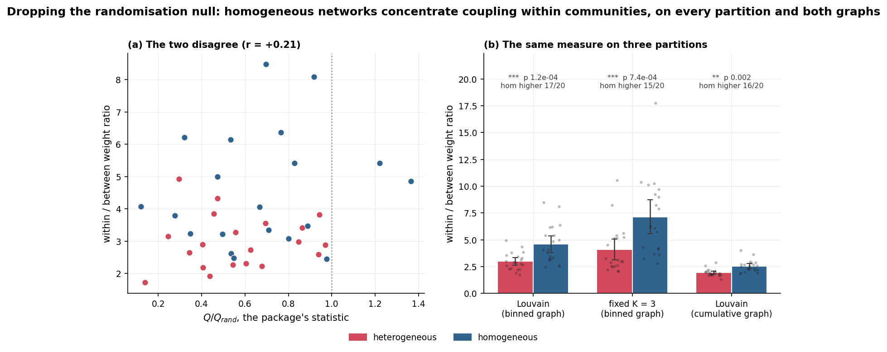

Panel (a) is the diagnostic: if Q/Q_rand measured what the block matrices show, the points would rise along a
line. They correlate at **r = 0.21**.

- **The randomisation barely randomises.** `randomize` calls `nx.double_edge_swap` inside a bare
  `except Exception: pass`. At density 0.89 almost every proposed swap would create an existing edge, so the
  call exhausts its retry budget and raises, and the weight reshuffle does most of the work.
- **The denominator is inflated.** Q_rand is the modularity Louvain *maximises* on the randomised graph.
  Maximised modularity on random data is substantially positive (Guimerà et al. 2004), and on a 47-node graph
  with ~950 edges it is large.
- **The clearest single case.** Seed 210's homogeneous network shows the brightest block structure of all
  forty by eye, and the *lowest* Q/Q_rand of all forty, at 0.12.

The same broken null sits under σ, since C_rand and L_rand come from the same swap.

### 8c. Without a null, the claim replicates

Mean within-community edge weight over mean between-community edge weight: what a block matrix displays, with
no randomisation in it.

| Partition | het | hom | Δ | d_z | paired t | Wilcoxon | sign-flip | hom higher |
|---|---:|---:|---:|---:|---:|---:|---:|---:|
| Louvain (binned graph) | 2.98 | 4.59 | -1.605 | -0.99 | 3.0e-04 | 1.3e-04 | 1.2e-04 | 17/20 |
| Fixed K = 3, spectral | 4.08 | 7.14 | -3.054 | -0.97 | 3.7e-04 | 0.001 | 7.4e-04 | 15/20 |
| Louvain (cumulative graph) | 1.93 | 2.54 | -0.6087 | -0.79 | 0.002 | 0.001 | 0.002 | 16/20 |

Every row favours hom. **The fixed-K row is the one that matters**: Louvain picks its partition to maximise
modularity and the arms find different community counts, so fixing the count removes that route and the
effect gets *larger*. Not a firing-rate artefact (r = 0.14 with mean edge MI). The cumulative row is the
sharpest correction: by weight concentration it agrees with the binned graph, so the reversal in 9a was the
statistic, not the data.

### 8d. Small-worldness, measured where the null works

σ = (C/C_rand)/(L/L_rand) is the package's own second topological signature, reported there as *"hom is
modular + small-world, σ up to 3.3"*. At matched density the graphs are sparse enough for the
degree-preserving swap to succeed, so σ becomes measurable (binary weighting):

| Density | het | hom | Δ | d_z | paired t | Wilcoxon | sign-flip | hom higher |
|---|---:|---:|---:|---:|---:|---:|---:|---:|
| 0.05 | 1.16 | 1.37 | -0.2035 | -0.31 | 0.184 | 0.430 | 0.190 | 11/20 |
| 0.10 | 1.14 | 1.32 | -0.1788 | -0.33 | 0.159 | 0.312 | 0.161 | 12/20 |
| 0.15 | 1.12 | 1.19 | -0.06943 | -0.23 | 0.315 | 0.294 | 0.316 | 13/20 |
| 0.20 | 1.09 | 1.16 | -0.06927 | -0.27 | 0.234 | 0.090 | 0.238 | 15/20 |
| 0.25 | 1.08 | 1.13 | -0.05151 | -0.28 | 0.223 | 0.261 | 0.226 | 12/20 |
| 0.30 | 1.06 | 1.12 | -0.05834 | -0.40 | 0.090 | 0.070 | 0.090 | 14/20 |

**Both arms are mildly small-world, hom higher at every density on 11–15/20, never significant.** The value
of 3.3 does not reproduce anywhere. The unthresholded σ in 9a runs the other way and is significant on the
cumulative graph (het higher, 16/20), but σ < 1 there in both arms, so that cell is measuring the broken null
rather than the graph.

### 8e. And modularity survives density matching

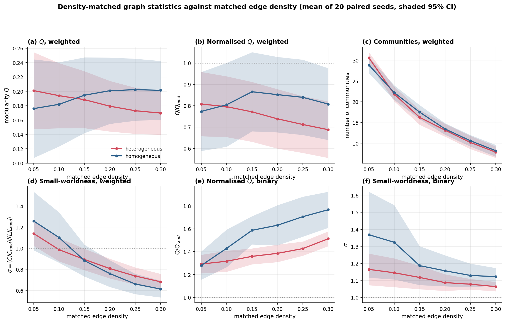

This is the package's own six-panel sweep, panel for panel, with each line now a twenty-seed mean and a 95%
CI band instead of one network's value.

| Weighting, density | het | hom | Δ | d_z | paired t | Wilcoxon | sign-flip | hom higher |
|---|---:|---:|---:|---:|---:|---:|---:|---:|
| weighted, d = 0.05 | 0.808 | 0.773 | +0.03453 | +0.07 | 0.761 | 0.841 | 0.759 | 9/20 |
| weighted, d = 0.10 | 0.796 | 0.804 | -0.00885 | -0.02 | 0.939 | 0.898 | 0.938 | 11/20 |
| weighted, d = 0.15 | 0.771 | 0.865 | -0.09411 | -0.18 | 0.435 | 0.452 | 0.430 | 13/20 |
| weighted, d = 0.20 | 0.739 | 0.852 | -0.1132 | -0.22 | 0.340 | 0.261 | 0.336 | 12/20 |
| weighted, d = 0.25 | 0.712 | 0.839 | -0.1273 | -0.25 | 0.270 | 0.245 | 0.267 | 12/20 |
| weighted, d = 0.30 | 0.688 | 0.808 | -0.12 | -0.24 | 0.289 | 0.245 | 0.285 | 12/20 |
| binary, d = 0.05 | 1.292 | 1.279 | +0.0125 | +0.04 | 0.866 | 0.756 | 0.866 | 9/20 |
| binary, d = 0.10 | 1.317 | 1.429 | -0.1126 | -0.25 | 0.276 | 0.294 | 0.276 | 10/20 |
| **binary, d = 0.15** | 1.359 | 1.587 | -0.2277 | -0.68 | 0.006 | 0.009 | 0.007 | 15/20 |
| **binary, d = 0.20** | 1.385 | 1.631 | -0.2457 | -0.55 | 0.024 | 0.024 | 0.024 | 14/20 |
| **binary, d = 0.25** | 1.427 | 1.706 | -0.2791 | -0.63 | 0.011 | 0.017 | 0.013 | 14/20 |
| **binary, d = 0.30** | 1.513 | 1.767 | -0.2537 | -0.65 | 0.009 | 0.015 | 0.010 | 13/20 |

Both arms are genuinely modular here (above 1.0), hom reliably more so from density 0.15 up. The weighted
sweep shows nothing (p 0.27–0.94), so the difference lives in *which pairs are connected*, not how strongly.
What does not survive is the size: about 1.18-fold against the 2.2-fold seed 1001 implied.

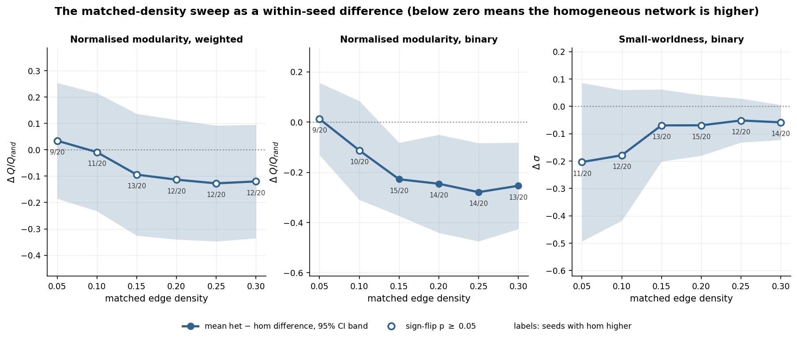

The same sweep as a paired within-seed difference, which is the quantity the tests are about: the two arms'
absolute levels move together across seeds, so differencing inside a seed removes between-seed variation the
paired test already discounts. Filled markers are densities where the sign-flip test clears 0.05.

### 8f. The structural figures, all forty networks

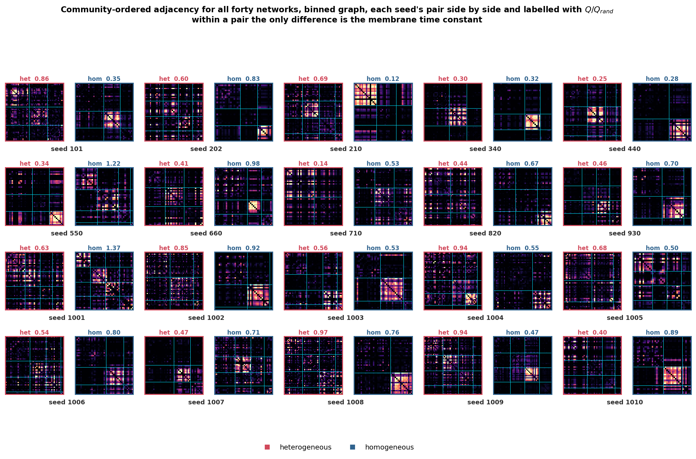

Community-ordered adjacency, each seed's pair side by side. Each panel is scaled to its own 99th percentile,
so brightness is not comparable across panels but the presence of diagonal blocks is.

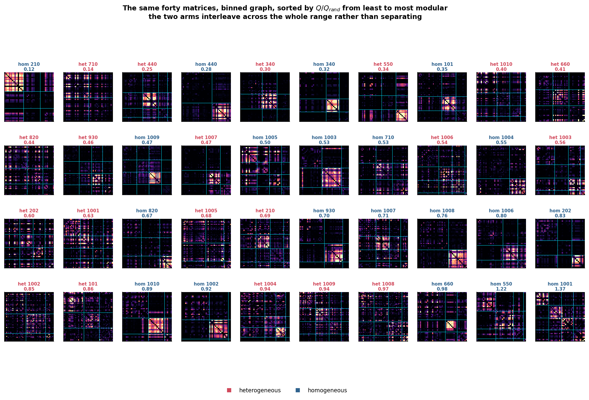

The same forty ordered by Q/Q_rand. If the arms differed *on that statistic* the title colours would
segregate; they interleave across the whole range.

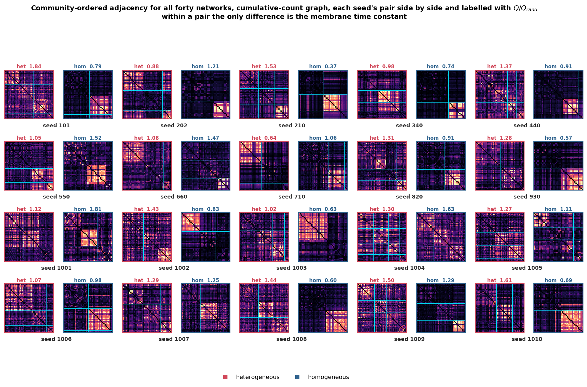

The same for the cumulative-count graph, seed-paired; `S15b_block_montage_sorted.png` is its sorted twin.

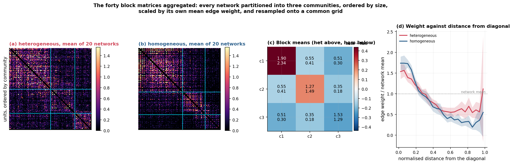

**Three normalisations make averaging forty matrices meaningful**, since unit index is arbitrary across
networks: units are ordered by community (largest first); every network is partitioned into exactly **three**
communities by spectral clustering so block boundaries land in comparable places; and each matrix is divided
by its own mean edge weight, so the arms' different weight scales cannot masquerade as different structure.
Active-unit counts still differ (34 to 58), so each matrix is resampled onto a common grid by proportional
position.

**This localises the difference, and not where I expected.** Panel (c) gives the nine block means:

| Block | het | hom | Δ | d_z | paired t | Wilcoxon | sign-flip | hom higher |
|---|---:|---:|---:|---:|---:|---:|---:|---:|
| Within-community (diagonal) | 1.568 | 1.707 | -0.1387 | -0.18 | 0.420 | 0.674 | 0.423 | 10/20 |
| **Between-community (off-diagonal)** | 0.470 | 0.298 | +0.1727 | +0.91 | 6.4e-04 | 0.001 | 0.001 | 4/20 |

The arms concentrate weight *within* communities to the same degree (a flat null, 10/20). What differs is
weight **between** communities, where het has substantially more (0.470 against 0.298, 16/20). So hom's
modules are not internally tighter, they are more **isolated**. Panel (d) shows the same as a profile:
indistinguishable near the diagonal, separating beyond about 0.4 of the way out.

**Does forcing three communities decide this?** Louvain finds more communities in het on both graphs, and on
the cumulative graph significantly so (3.40 against 2.75, p = 0.001; the binned graph is 3.50 against 3.10,
p = 0.136). Recomputed at every K from 2 to 6:

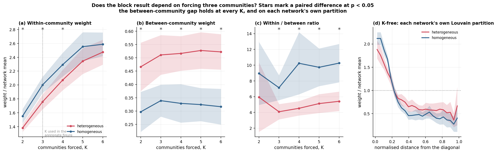

| K | within het | within hom | p | between het | between hom | p | ratio p |
|---:|---:|---:|---:|---:|---:|---:|---:|
| 2 | 1.381 | 1.551 | 0.010 | 0.466 | 0.297 | **0.005** | 0.355 |
| 3 | 1.758 | 2.002 | 0.011 | 0.511 | 0.339 | **0.002** | **0.001** |
| 4 | 2.071 | 2.293 | 0.033 | 0.516 | 0.329 | **0.002** | **0.001** |
| 5 | 2.344 | 2.553 | 0.177 | 0.527 | 0.324 | **0.001** | **0.001** |
| 6 | 2.474 | 2.587 | 0.332 | 0.522 | 0.316 | **0.001** | **0.001** |

**The between-community gap holds at every K** (p 0.001 to 0.005), flat across the sweep. The
within-community difference is the K-dependent one: significant at K = 2 to 4, gone by K = 5.

Forcing K below an arm's natural count merges communities, moving pairs from the between set into the within
set. Since het has (slightly) more natural communities, K = 3 biases *against* the reported result, which
survives the bias rather than being produced by it. **Giving each arm its own K is worse than it looks**: the
arms would then have different numbers of within-pairs and between-pairs, so the means stop being comparable
and the aggregate pictures cannot be read side by side. Panel (d) is the K-free check, using each network's
own Louvain partition whatever its size, and shows the same thing.

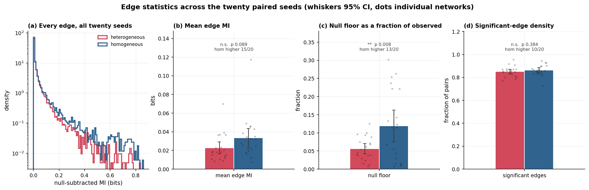

Het's mean edge MI is **lower** at n = 20 (0.023 against 0.033, 15/20), reversing the seed-1001 reading,
though not significant (p = 0.089). Its surrogate null floor is a smaller fraction of observed MI (0.056
against 0.119, p = 0.008), and significant-edge density is equal (p = 0.384), so neither arm has a denser
graph to work with.

### 8g. The double dissociation is half a dissociation

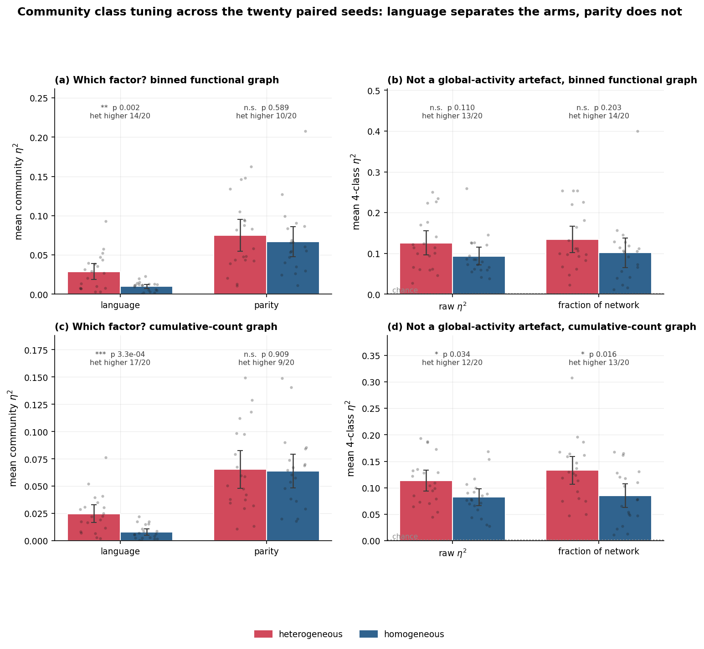

| Graph, factor | het | hom | Δ | d_z | paired t | Wilcoxon | sign-flip | wins |
|---|---:|---:|---:|---:|---:|---:|---:|---:|
| **binned, language** | 0.0288 | 0.0101 | +0.01871 | +0.73 | 0.004 | 0.011 | 0.002 | 14/20 |
| binned, parity | 0.0752 | 0.0668 | +0.008433 | +0.12 | 0.590 | 0.498 | 0.589 | 10/20 |
| **cumulative, language** | 0.0248 | 0.0079 | +0.0169 | +0.88 | 9.0e-04 | 3.9e-04 | 3.3e-04 | 17/20 |
| cumulative, parity | 0.0653 | 0.0639 | +0.001478 | +0.03 | 0.909 | 0.898 | 0.909 | 9/20 |

Language replicates on both graphs, more strongly on the cumulative one; parity is a flat null on both. And
**both arms encode parity roughly three times more strongly than language**, so this is a language difference
on a shared parity-dominant background, not a double dissociation. The right-hand panels are the confound
guard: expressing community activity as a share of the trial's total spikes rather than a raw count leaves
the picture unchanged.

---

## 9. Redundancy and synergy

**Claim under test.** *"het pairs are BOTH more redundant (0.104 vs 0.051) and more synergistic (0.187 vs
0.097), higher net RSI (0.082 vs 0.046). JMI-normalised: redundancy and synergy fractions survive but net
RSI-fraction is null."*

**Verdict: the scale claims replicate strongly; the balance claim needs correcting.**

| Metric | het | hom | Δ | d_z | paired t | Wilcoxon | sign-flip | wins |
|---|---:|---:|---:|---:|---:|---:|---:|---:|
| Single-unit MI I(X_i;Y) | 0.1924 | 0.1504 | +0.04206 | +0.91 | 6.2e-04 | 3.9e-04 | 4.7e-04 | 16/20 |
| Pair joint MI | 0.4272 | 0.3482 | +0.07894 | +0.98 | 3.2e-04 | 1.3e-04 | 1.9e-04 | 18/20 |
| Redundancy min(I_i,I_j) | 0.1352 | 0.0995 | +0.03572 | +1.10 | 9.6e-05 | 4.8e-05 | 6.5e-05 | 17/20 |
| Synergy I_joint − max(I_i,I_j) | 0.1776 | 0.1470 | +0.03055 | +0.89 | 7.9e-04 | 2.6e-04 | 3.3e-04 | 16/20 |
| **RSI = synergy − redundancy** | 0.0424 | 0.0475 | -0.005172 | -0.15 | 0.508 | 0.546 | 0.504 | 10/20 |
| Redundancy / I_joint | 0.3190 | 0.2878 | +0.03116 | +0.77 | 0.003 | 0.002 | 0.004 | 15/20 |
| Synergy / I_joint | 0.4110 | 0.4192 | -0.00813 | -0.14 | 0.535 | 0.409 | 0.533 | 7/20 |
| **RSI / I_joint** | 0.0921 | 0.1314 | -0.03929 | -0.45 | 0.058 | 0.070 | 0.059 | 7/20 |

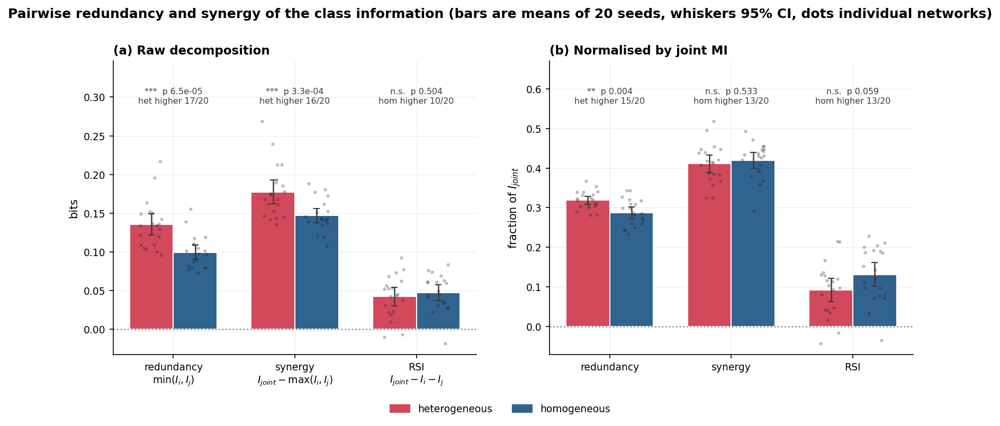
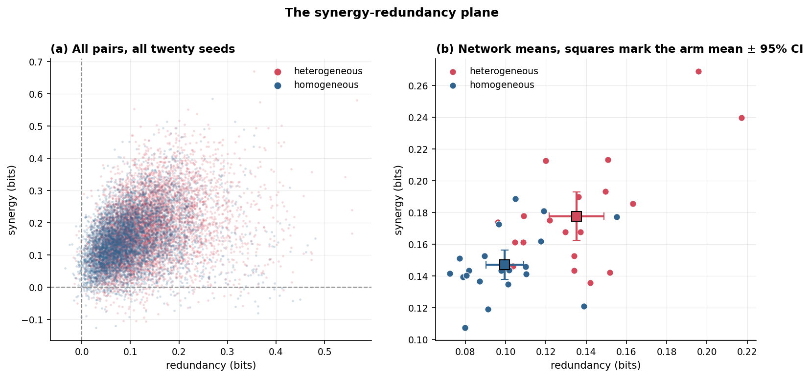

Two corrections. Net RSI in bits was a het advantage at n = 1 (0.082 vs 0.046); at twenty seeds it is a
**null** (p = 0.504, an exact 10/20). And the normalised balance does not merely fail to differ, it leans
**homogeneous**, reaching **p = 0.010, 5/20** when RSI is recomputed under the package's own active-unit
rule (any unit with at least one spike, rather than the ≥0.5% filter used throughout here). Consistent with
a scale effect, RSI fraction correlates negatively with joint MI across all forty networks (r = −0.38). So
heterogeneity buys more information of both kinds, and as a *fraction* the code becomes marginally more
**redundant**, not more synergistic.

---

## 10. Timing and lock-in order

**Claim under test.** *"hom locks in language early (232 ms) then parity late (408 ms), a clean ~176 ms
language→parity sequence, while het locks both in late and close together."*

**Verdict: holds, but as a tendency rather than a rule.**

| Metric | het | hom | Δ | d_z | paired t | Wilcoxon | sign-flip | wins |
|---|---:|---:|---:|---:|---:|---:|---:|---:|
| 4-class lock-in (ms) | 550.9 | 430.7 | +120.2 | +0.76 | 0.003 | 0.003 | 0.004 | 17/20 |
| Language lock-in (ms) | 551.6 | 353.1 | +198.5 | +0.99 | 2.9e-04 | 7.1e-04 | 5.3e-04 | 17/20 |
| Parity lock-in (ms) | 578.8 | 468.8 | +110 | +0.75 | 0.003 | 0.003 | 0.004 | 17/20 |
| Instantaneous language COM (ms) | 426.9 | 320.7 | +106.2 | +1.09 | 1.1e-04 | 2.1e-04 | 1.7e-04 | 16/20 |
| Lock-in gap (parity − language, ms) | 27.3 | 115.7 | -88.49 | -0.35 | 0.132 | 0.165 | 0.132 | 8/20 |
| Instantaneous COM gap (ms) | 63.6 | 141.7 | -78.17 | -0.56 | 0.021 | 0.024 | 0.022 | 7/20 |

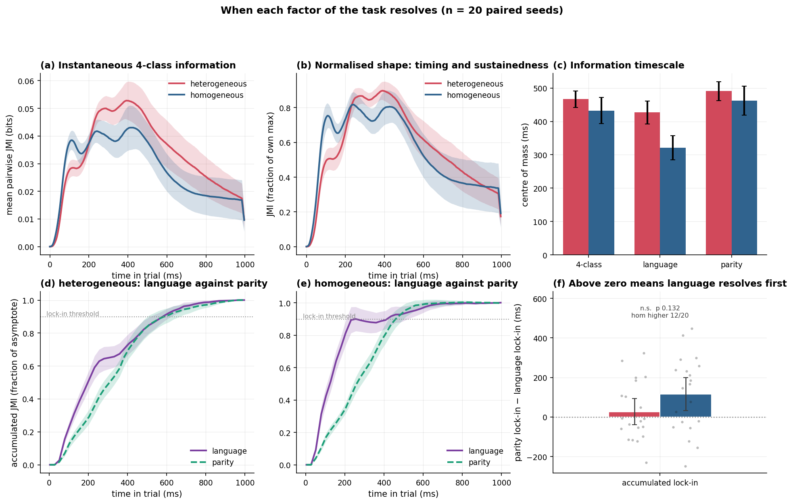

Het integrates longer on every target, 17/20. The largest single gap is on *language* (+199 ms).

**Is either arm actually ordered?** The prior question n = 1 could not ask. One-sample sign-flip on the
twenty per-seed gaps:

| Arm | Clock | Mean gap | Median | Language first | p |
|---|---|---:|---:|---:|---:|
| hom | accumulated lock-in | +116 ms | +156 ms | **13/20** | **0.015** |
| hom | instantaneous COM | +142 ms | +117 ms | **18/20** | **2.7e-05** |
| het | accumulated lock-in | +27 ms | −14 ms | 8/20 | 0.425 |
| het | instantaneous COM | +64 ms | +55 ms | 15/20 | 0.001 |

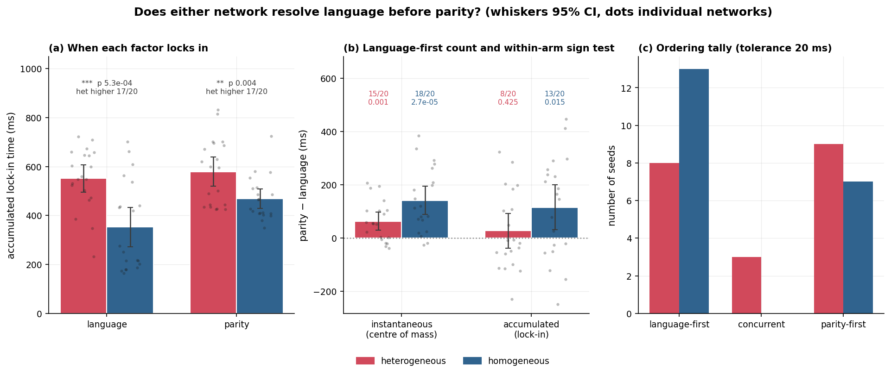

**The ordering result is real**, but seven of twenty homogeneous networks resolve parity first and per-seed
gaps run from −248 ms to +448 ms:

| | language-first | concurrent | parity-first |
|---|---:|---:|---:|
| heterogeneous | 8 | 3 | 9 |
| homogeneous | **13** | 0 | 7 |

So "hom does language then parity" describes about two thirds of homogeneous networks; as "hom is a
sequential processor" it claims more than twenty seeds support.

**The two clocks disagree about het, and that is informative.** Het is *also* language-first on the
instantaneous clock (15/20, p = 0.001) at half hom's gap, but at chance on the accumulated one (8/20,
p = 0.425). The instantaneous profile asks when information is momentarily present, the accumulated one when
the decision variable commits: het carries the same early language signal without converting it into an early
*commitment*.

---

## 11. Division of labour

**Claim under test.** *"Module identity predicts factor preference in hom (η² 0.27, p = 0.007) but not het
(0.09, p = 0.26). The keystone tying modular + timescale."*

**Verdict: replicates.**

| Metric | het | hom | Δ | d_z | paired t | Wilcoxon | sign-flip | hom higher |
|---|---:|---:|---:|---:|---:|---:|---:|---:|
| **η²(selectivity ~ module)** | 0.113 | 0.211 | -0.09822 | -0.58 | 0.018 | 0.021 | 0.019 | 14/20 |
| **η² above its own permutation null** | 0.059 | 0.160 | -0.1009 | -0.61 | 0.013 | 0.015 | 0.015 | 13/20 |
| corr(language MI, parity MI) | 0.116 | 0.108 | +0.008394 | +0.03 | 0.888 | 1.000 | 0.887 | 11/20 |
| Jaccard, top language/parity units | 0.187 | 0.161 | +0.02661 | +0.18 | 0.422 | 0.341 | 0.421 | 9/20 |

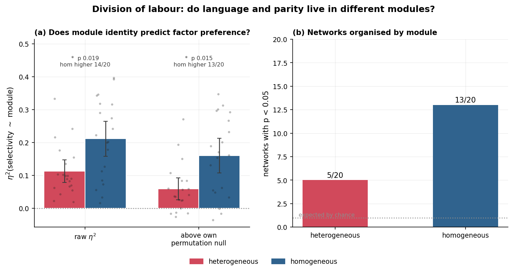

Within-network permutation tests reached p < 0.05 in **13/20 homogeneous** networks against **5/20
heterogeneous**, on about 1/20 expected by chance. The **η²-above-null row is the one to quote**: raw η²
rises with the number of modules, so each network is compared against its own permutation null first. The two
supporting measures do not carry weight at n = 20, borne out by the note that they were noisy and that
analysis B should be the anchor.

**Why this is the most interesting result.** It survives while the modularity statistic underneath it did
not. The original architecture was: hom graphs are modular, therefore sub-tasks segregate into modules. Both
hold, but *independently*: the functional result never depended on Q/Q_rand, which is fortunate given 8b.

---

## 12. Part II in one table

| Axis | Package (n = 1) | At n = 20 |
|---|---|---|
| Class information per unit and pair | het higher | **replicates**, d_z 0.9–1.1, 16–18/20 |
| Redundancy and synergy, in bits | both higher in het | **replicates**, 16–17/20 |
| Net RSI, in bits | het higher | **null**, 10/20, p = 0.504 |
| Redundancy–synergy balance | invariant | leans **homogeneous** (p = 0.010 under package settings) |
| Integration timescale | het longer | **replicates**, 17/20 |
| hom resolves language before parity | clean 176 ms sequence | **holds, 13/20, p = 0.015**, modal not universal |
| het concurrent | yes | holds, refined: early signal, late commitment |
| Functional graph modularity | hom modular, het near-random | **replicates** via weight concentration (p 1.2e-04) and matched density (p 0.007); effect size inflated |
| Cumulative-graph modularity | hom far more modular | **replicates** via weight concentration (p 0.002) |
| Q/Q_rand as a statistic | the headline measure | **unreliable here**, tracks block structure at r = 0.21 |
| Small-worldness | σ up to 3.3 | direction holds at matched density, never significant; 3.3 does not reproduce |
| Module double dissociation | language vs parity | **half**: language real, parity a null |
| Division of labour by module | hom yes, het no | **replicates**, p = 0.015–0.019, 13–14/20 |

**One line.** Heterogeneity produces a code that carries more class information and integrates it over a
longer window; homogeneity produces one that commits earlier, concentrates its coupling into modules, and
divides its units by what they encode. The package's picture survives twenty seeds. Its headline *number*
does not, because Q/Q_rand is the wrong instrument for a graph this dense.

## Where everything lives

- Runnable notebook: `Cross-Seed Replication.ipynb`
- Part I code: `code/analysis_suite/`; Part II code: `code/supervisor_extension/`
- Per-network result values: `results/*.json`
- Spike caches for all forty networks: supplied separately by shared link (bit-packed, with `MANIFEST.json`)
- Full paired statistics: `significance_tables.md`
- Claim-by-claim verdicts: `replication_evidence.md`
- Method deviations: `METHOD_NOTES.md`
